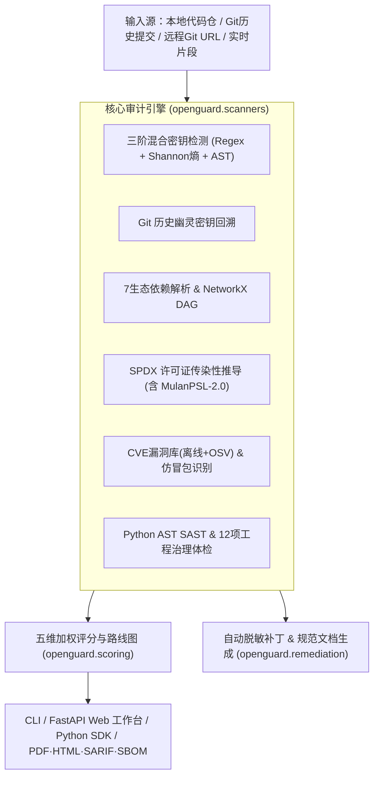

# OpenGuard（开源卫士）

**面向开源软件供应链的敏感信息检测、许可证合规与工程规范自动化审计平台**

[](LICENSE)
[](https://github.com/YunHai121/OpenGuard/actions/workflows/openguard.yml)
[-blue.svg)](pyproject.toml)
[](docs/assets/openguard_badge.svg)

---

## 项目简介

**OpenGuard（开源卫士）** 聚焦于高校师生、个人开发者及中小开源团队在代码开源发布与日常协作中最容易踩坑的三类核心风险：**代码与 Git 历史敏感凭据泄露**、**第三方依赖传染性许可证冲突与已知供应链漏洞（含仿冒投毒）**、以及**开源工程规范缺失**。

项目采用 **CLI 命令行 + FastAPI 可视化 Web 工作台 + Python SDK 库 + Git Pre-commit 拦截钩子** 四位一体架构，内置三阶混合检测引擎（指纹正则 + Shannon 信息熵 + Python AST 语义上下文降噪），在显著压低传统扫描器高误报率的同时，提供**自动脱敏重构补丁**、**标准 SBOM 导出**与**中文 PDF/交互式 HTML 审计报告**。

---

## 核心功能亮点

1. **三阶混合敏感信息检测与 Git 历史幽灵密钥回溯**
   - 内置 **46 条** 高危规则：覆盖 AWS / 阿里云 / 腾讯云 / 华为云 / GCP / Azure、OpenAI / Claude / DeepSeek / 通义千问 / HuggingFace / Groq、GitHub / GitLab / Gitee / PyPI / npm、**飞书 / 钉钉 / 企业微信机器人 Webhook**、RSA/OpenSSH 私钥、数据库连接串、JWT 与中国居民身份证号（ISO 7064 MOD 11-2 校验）/ 银行卡（Luhn 校验）。
   - **三阶降噪引擎**：自动过滤文档字符串（AST Docstring）、`re.compile()` 正则规则定义、`os.getenv()` 调用、占位符词根、UUID 与纯十六进制摘要。
   - **Git 历史回溯（`--git-history`）**：支持挖掘已从最新工作区删除但仍残留在 `.git` 历史 Commit 中的“幽灵密钥”。

2. **7 大生态依赖解析（含现代锁文件）、SBOM/VEX 构建与许可证传染性冲突推导**
   - 零编译静态解析 **PyPI / npm / Go / Maven / Rust / C++ / PHP** 依赖清单与现代锁文件（`requirements.txt`、`pyproject.toml`、`uv.lock`、`poetry.lock`、`package-lock.json`、`yarn.lock`、`pnpm-lock.yaml`、`go.mod`、`pom.xml`、`Cargo.lock` 等），构建 `NetworkX` 依赖有向图并导出 **CycloneDX 1.5（含自动 VEX 可利用性分析）** 与 **SPDX 2.3** 标准 SBOM。
   - 支持 **20+ SPDX 主许可证识别（含木兰宽松许可证 `MulanPSL-2.0`）**，通过最短依赖路径算法自动定位 `MIT/Apache-2.0` 项目误引入 `GPL/AGPL/LGPL` 依赖的传染链条。

3. **函数级 CVE 可达性、CI/CD 与 Dockerfile 供应链审计 + 多语言 SAST**
   - 融合本地高危 CVE 知识库与 OSV.dev 批量接口，结合 **Python/JS/Go 函数调用级可达性分析**区分为 `call_reachable` / `import_only` / `unreachable` 三档，自动生成 CycloneDX VEX (`code_not_reachable`) 并对不可达漏洞评分降权。
   - 静态扫描 `.github/workflows/*.yml`（未锁 40 位 SHA 的 Action、宽泛 `permissions`、`pull_request_target` 风险、表达式注入）、`.gitlab-ci.yml`、`Dockerfile`（`:latest`、root 运行、`ENV` 密钥、`curl | sh`）以及 `package.json` / `setup.py` 安装脚本投毒。
   - 基于 Levenshtein 编辑距离检测拼写仿冒包（`reqeusts`）与 AI 幻觉包（Slopsquatting），内置 Python AST / JS / Shell / Go SAST。

4. **Diff-Aware 增量门禁、Baseline 基线、一键修复闭环 (`autofix`) 与 AI MCP Server**
   - 支持 `--diff origin/main` PR 增量扫描、`openguard baseline create` 存量债务基线、`--format pr-comment` 紧凑 PR 评审评论与 `.pre-commit-hooks.yaml` 零配置接入。
   - **`autofix` 三位一体自动修复**：支持硬编码密钥环境变量重构（`--secrets`）、漏洞依赖最小安全升级（`--deps`）及开源规范文档补齐（`--docs`），均默认 dry-run Diff 预览并自动备份至 `.openguard_backup/`。
   - **内置 MCP Server (`openguard mcp`)**：零额外依赖向 Claude Code / Cursor / Antigravity 暴露 `audit_repository`、`audit_code_snippet`、`check_package_safety` 与 `generate_pr_comment` 工具。

5. **极简工程风离线 Web 工作台与多格式报告**
   - 零外网 CDN 依赖的 Light-First 工程界面（支持深色切换与 `Ctrl+K` 全局检索）：包含质量门禁总览、Master-Detail 源码上下文溯源分栏、SVG 依赖传播图与整改前后 Diff 对比。
   - 支持导出 **HTML、中文 PDF（ReportLab）、SARIF 2.1.0、CycloneDX 1.5、SPDX 2.3、Markdown、JSON 及 SVG 徽章**。

---

## 系统架构



---

## 快速开始

### 1. 安装

```bash
git clone https://github.com/YunHai121/OpenGuard.git
cd OpenGuard
pip install -r requirements.txt
pip install -e . --no-build-isolation --no-deps
openguard version
```

### 2. 10 秒体验内置问题靶场

```bash
# 扫描内置问题仓库并生成全套报告（HTML / PDF / SARIF / CycloneDX / SPDX / MD / SVG）
openguard scan examples/vulnerable_demo_repo --offline --format all --output demo_outputs/demo_audit

# 体验 Git 历史幽灵密钥挖掘
python examples/setup_demo_git_history.py
openguard scan demo_outputs/demo_git_repo --git-history --offline

# 启动可视化 Web 工作台
openguard serve --open
```

### 3. 一键自动修复、增量 PR 门禁与 Pre-commit 防线

```bash
# 预览硬编码密钥重构、漏洞依赖升级与缺失开源文档差异（加 --apply 执行写入）
openguard autofix path/to/your_repo --secrets --deps --docs --license MIT

# 老项目零痛苦接入：生成基线 + Diff-Aware PR 增量扫描 + 生成 PR 评审评论
openguard baseline create path/to/your_repo -o .openguard-baseline.json
openguard scan path/to/your_repo --diff origin/main --baseline .openguard-baseline.json --format pr-comment -o pr_comment.md

# 安装提交前防泄密 Git Hook 与 git.hust.edu.cn GitLab CI
openguard hook install path/to/your_repo
openguard hook ci path/to/your_repo --ci-platform gitlab
```

也支持直接通过 `.pre-commit-config.yaml` 零配置接入任何 GitHub 仓库：

```yaml
repos:
  - repo: https://github.com/YunHai121/OpenGuard
    rev: v1.2.0
    hooks:
      - id: openguard-staged
```

### 4. AI 编程助手 MCP Server 集成（Claude Code / Cursor / Antigravity）

```json
{
  "mcpServers": {
    "openguard": {
      "command": "openguard",
      "args": ["mcp"]
    }
  }
}
```

接入后，AI 编程助手可在写入代码或执行 `pip install` / `npm install` 前自动调用 `audit_code_snippet`、`check_package_safety`（防仿冒包与 AI 幻觉包 Slopsquatting）与 `audit_repository`。

### 5. Python SDK 第三方集成

```python
from openguard import AuditConfig, OpenGuardAuditor

auditor = OpenGuardAuditor(AuditConfig(offline=True, include_git_history=True))
report = auditor.audit("./my_project")
print(report.summary.total_score, report.summary.grade)
auditor.export_report(report, "pdf", "audit_report.pdf")
```

完整集成示例见 [examples/third_party_ci_integration.py](examples/third_party_ci_integration.py)。

---

## 可复现性能与准确率对比实验

在 220 条标注样本基准测试集（100 条真实高危密钥 + 120 条占位符/UUID/SHA256/AST 文档字符串/正则定义等高干扰误报诱饵）上执行 `python benchmarks/run_benchmark.py` 的实测结果如下：

| 检测引擎 | Precision | Recall | F1-Score | 误报率 (FPR) | 耗时 (ms) |
| :--- | :---: | :---: | :---: | :---: | :---: |
| Baseline-A: Pure Regex | 0.5714 | 1.0000 | 0.7273 | 0.6250 | 18.71 |
| Baseline-B: Pure Shannon Entropy | 0.4511 | 0.6000 | 0.5150 | 0.6083 | 3.64 |
| **OpenGuard: 3-Stage Hybrid (Regex + Entropy + AST)** | **1.0000** | **1.0000** | **1.0000** | **0.0000** | 36.13 |

> 相比纯正则基线，OpenGuard 三阶混合引擎将测试集误报率降低了 **100.0%**，同时保持 **100.0%** 召回率。完整测试报告见 [benchmarks/BENCHMARK_REPORT.md](benchmarks/BENCHMARK_REPORT.md)。

---

## 文档目录

- [安装与完整使用指南](docs/INSTALLATION_AND_USAGE.md)
- [系统架构与核心算法说明](docs/ARCHITECTURE.md)
- [问题处理与缺陷修复记录](docs/ISSUE_RESOLUTION_LOG.md)
- [开源贡献指南](CONTRIBUTING.md)
- [安全策略与漏洞披露](SECURITY.md)
- [版本迭代记录](CHANGELOG.md)
- [MIT 开源许可证](LICENSE)
