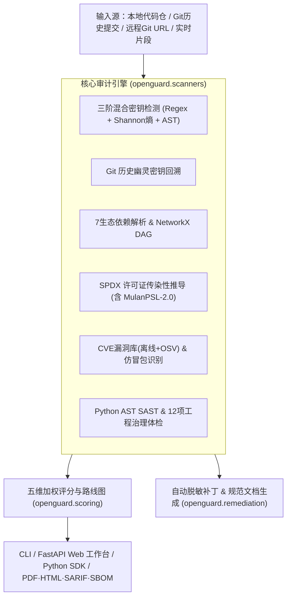

# OpenGuard（开源卫士）

**面向开源软件供应链的敏感信息检测、许可证合规与工程规范自动化审计平台**

[](LICENSE)
[-blue.svg)](pyproject.toml)
[](docs/assets/openguard_badge.svg)

---

## 项目简介

**OpenGuard（开源卫士）** 聚焦于高校师生、个人开发者及中小开源团队在代码开源发布与日常协作中最容易踩坑的三类核心风险：**代码与 Git 历史敏感凭据泄露**、**第三方依赖传染性许可证冲突与已知供应链漏洞（含仿冒投毒）**、以及**开源工程规范缺失**。

项目采用 **CLI 命令行 + FastAPI 可视化 Web 工作台 + Python SDK 库 + Git Pre-commit 拦截钩子** 四位一体架构，内置三阶混合检测引擎（指纹正则 + Shannon 信息熵 + Python AST 语义上下文降噪），在显著压低传统扫描器高误报率的同时，提供**自动脱敏重构补丁**、**标准 SBOM 导出**与**中文 PDF/交互式 HTML 审计报告**。

---

## 核心功能亮点

1. **三阶混合敏感信息检测与 Git 历史幽灵密钥回溯**
   - 内置 **46 条** 高危规则：覆盖 AWS / 阿里云 / 腾讯云 / 华为云 / GCP / Azure、OpenAI / Claude / DeepSeek / 通义千问 / HuggingFace / Groq、GitHub / GitLab / Gitee / PyPI / npm、**飞书 / 钉钉 / 企业微信机器人 Webhook**、RSA/OpenSSH 私钥、数据库连接串、JWT 与中国居民身份证号（ISO 7064 MOD 11-2 校验）/ 银行卡（Luhn 校验）。
   - **三阶降噪引擎**：自动过滤文档字符串（AST Docstring）、`re.compile()` 正则规则定义、`os.getenv()` 调用、占位符词根、UUID 与纯十六进制摘要。
   - **Git 历史回溯（`--git-history`）**：支持挖掘已从最新工作区删除但仍残留在 `.git` 历史 Commit 中的“幽灵密钥”。

2. **7 大生态依赖解析、SBOM 构建与许可证传染性冲突推导**
   - 零编译静态解析 **PyPI / npm / Go / Maven / Rust / C++ / PHP** 依赖清单与锁文件（`requirements.txt`、`pyproject.toml`、`package-lock.json`、`go.mod`、`pom.xml`、`Cargo.lock` 等），构建 `NetworkX` 依赖有向图并导出 **CycloneDX 1.5** 与 **SPDX 2.3** 标准 SBOM。
   - 支持 **20+ SPDX 主许可证识别（含木兰宽松许可证 `MulanPSL-2.0`）**，通过最短依赖路径算法自动定位 `MIT/Apache-2.0` 项目误引入 `GPL/AGPL/LGPL` 依赖的传染链条。

3. **供应链已知漏洞与投毒检测 + Python AST SAST**
   - 融合本地高危 CVE 知识库（含 Log4Shell、Spring4Shell、PyYAML、urllib3、lodash、minimist 等）与 OSV.dev 批量接口，支持 `--offline` 全离线运行。
   - 基于 Levenshtein 编辑距离检测热门包的拼写仿冒包（Typosquatting，如 `reqeusts` 仿冒 `requests`）。
   - 内置 Python AST 静态代码安全分析（`CWE-95/502/78/89/295/327/489`）及 JS/Shell 安全规则。

4. **五维量化评分模型 + 一键自动脱敏重构 (`autofix`)**
   - 从密钥安全（30%）、供应链漏洞（20%）、许可证合规（20%）、代码安全（15%）、工程治理（15%）五个维度输出 `0~100` 量化得分与优先级整改路线图。
   - **`autofix` 自动修复**：一键预览 Unified Diff 并将硬编码密钥替换为 `os.getenv` / `process.env`（自动生成 `.env.example` 与备份 `.openguard_backup/`），同时支持一键补齐 `LICENSE`、`CONTRIBUTING.md`、`SECURITY.md`、`CHANGELOG.md`、`.gitignore` 与 `.gitlab-ci.yml`（适配校内 `git.hust.edu.cn`）。

5. **离线可用的 FastAPI 可视化工作台与多格式报告**
   - 零外网 CDN 依赖的现代 Web 控制台（评分仪表盘、五维 SVG 雷达图、SVG 依赖拓扑图、Live Snippet 实时代码检测台、SQLite 审计历史与整改前后 Diff 对比）。
   - 支持导出 **HTML、中文 PDF（ReportLab）、SARIF 2.1.0、CycloneDX 1.5、SPDX 2.3、Markdown、JSON 及 SVG 徽章**。

---

## 系统架构



---

## 快速开始

### 1. 安装

```bash
git clone <repository-url> OpenGuard
cd OpenGuard
pip install -r requirements.txt
pip install -e . --no-build-isolation --no-deps
openguard version
```

### 2. 10 秒体验内置问题靶场

```bash
# 扫描内置问题仓库并生成全套报告（HTML / PDF / SARIF / CycloneDX / SPDX / MD / SVG）
openguard scan examples/vulnerable_demo_repo --offline --format all --output demo_outputs/demo_audit

# 体验 Git 历史幽灵密钥挖掘
python examples/setup_demo_git_history.py
openguard scan demo_outputs/demo_git_repo --git-history --offline

# 启动可视化 Web 工作台
openguard serve --open
```

### 3. 一键自动修复与 Pre-commit 防线

```bash
# 预览脱敏修改与缺失开源文档差异
openguard autofix path/to/your_repo --secrets --docs --license MIT

# 安装提交前防泄密 Git Hook 与 git.hust.edu.cn GitLab CI
openguard hook install path/to/your_repo
openguard hook ci path/to/your_repo --ci-platform gitlab
```

### 4. Python SDK 第三方集成

```python
from openguard import AuditConfig, OpenGuardAuditor

auditor = OpenGuardAuditor(AuditConfig(offline=True, include_git_history=True))
report = auditor.audit("./my_project")
print(report.summary.total_score, report.summary.grade)
auditor.export_report(report, "pdf", "audit_report.pdf")
```

完整集成示例见 [examples/third_party_ci_integration.py](examples/third_party_ci_integration.py)。

---

## 可复现性能与准确率对比实验

在 220 条标注样本基准测试集（100 条真实高危密钥 + 120 条占位符/UUID/SHA256/AST 文档字符串/正则定义等高干扰误报诱饵）上执行 `python benchmarks/run_benchmark.py` 的实测结果如下：

| 检测引擎 | Precision | Recall | F1-Score | 误报率 (FPR) | 耗时 (ms) |
| :--- | :---: | :---: | :---: | :---: | :---: |
| Baseline-A: Pure Regex | 0.5714 | 1.0000 | 0.7273 | 0.6250 | 18.71 |
| Baseline-B: Pure Shannon Entropy | 0.4511 | 0.6000 | 0.5150 | 0.6083 | 3.64 |
| **OpenGuard: 3-Stage Hybrid (Regex + Entropy + AST)** | **1.0000** | **1.0000** | **1.0000** | **0.0000** | 36.13 |

> 相比纯正则基线，OpenGuard 三阶混合引擎将测试集误报率降低了 **100.0%**，同时保持 **100.0%** 召回率。完整测试报告见 [benchmarks/BENCHMARK_REPORT.md](benchmarks/BENCHMARK_REPORT.md)。

---

## 文档目录

- [安装与完整使用指南](docs/INSTALLATION_AND_USAGE.md)
- [系统架构与核心算法说明](docs/ARCHITECTURE.md)
- [问题处理与缺陷修复记录](docs/ISSUE_RESOLUTION_LOG.md)
- [开源贡献指南](CONTRIBUTING.md)
- [安全策略与漏洞披露](SECURITY.md)
- [版本迭代记录](CHANGELOG.md)
- [MIT 开源许可证](LICENSE)
