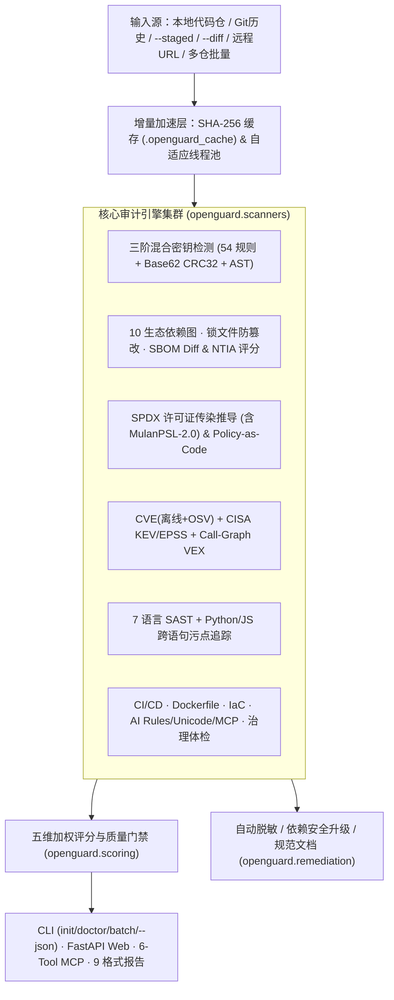

# OpenGuard（开源卫士）

**面向开源软件供应链的敏感信息检测、许可证合规与工程规范自动化审计平台**

[](LICENSE)
[](https://github.com/YunHai121/OpenGuard/actions/workflows/openguard.yml)
[-blue.svg)](pyproject.toml)
[](docs/assets/openguard_badge.svg)

---

## 项目简介

**OpenGuard（开源卫士）** 聚焦于高校师生、个人开发者及中小开源团队在代码开源发布与日常协作中最容易踩坑的三类核心风险：**代码与 Git 历史敏感凭据泄露**、**第三方依赖传染性许可证冲突与已知供应链漏洞（含仿冒投毒）**、以及**开源工程规范缺失**。

项目采用 **CLI 命令行 + FastAPI 可视化 Web 工作台 + Python SDK 库 + Git Pre-commit 拦截钩子** 四位一体架构，内置三阶混合检测引擎（指纹正则 + Shannon 信息熵 + Python AST 语义上下文降噪），在显著压低传统扫描器高误报率的同时，提供**自动脱敏重构补丁**、**标准 SBOM 导出**与**中文 PDF/交互式 HTML 审计报告**。

---

## 核心功能亮点

1. **三阶混合敏感信息检测（54 条规则 + 离线数学校验）与 Git 历史幽灵密钥回溯**
   - 内置 **54 条** 高危规则：覆盖 AWS / 阿里云 / 腾讯云 / 华为云 / GCP / Azure / **Supabase（自动区分 `service_role` 致命管理员密钥与公开 `anon` 密钥零误报）** / Vercel、OpenAI / Anthropic（含 Admin/OAuth） / **OpenRouter / xAI Grok / Perplexity / LangSmith** / DeepSeek / 通义千问 / 豆包 Ark / HuggingFace / Groq、GitHub / GitLab 17+ Routable Token / Gitee / PyPI / npm / Linear、**飞书 / 钉钉 / 企业微信机器人 Webhook**、RSA/OpenSSH 私钥、数据库连接串、JWT 与中国居民身份证号（ISO 7064 MOD 11-2）/ 银行卡（Luhn）。
   - **三阶降噪 + 离线数学校验**：内置 GitHub/npm Base62 CRC32 校验、AST Docstring/`re.compile()`/`os.getenv()` 过滤、占位符/UUID/纯十六进制摘要降噪，并支持 SHA-256 内容增量缓存（`--cache`）与自适应多线程并发扫描。
   - **Git 历史回溯（`--git-history`）**：支持挖掘已从最新工作区删除但仍残留在 `.git` 历史 Commit 中的“幽灵密钥”。

2. **10 大生态依赖解析、SBOM Diff 漂移守卫、NTIA 评分与 SLSA v1.0 证明**
   - 零编译静态解析 **PyPI / npm / Go / Maven / Rust / C++ / PHP / RubyGems / .NET NuGet / GitHub Actions** 10 大生态清单与锁文件（`requirements.txt`、`pyproject.toml`、`uv.lock`、`poetry.lock`、`package-lock.json`、`yarn.lock`、`pnpm-lock.yaml`、`go.mod`、`go.sum`、`pom.xml`、`Cargo.lock`、`Gemfile.lock`、`composer.lock`、`*.csproj`、`.github/workflows/*.yml`），导出 **CycloneDX 1.5（含自动 VEX 与 KEV/EPSS 属性）**、**SPDX 2.3** 与 **SLSA v1.0 / in-toto 完整性证明（`openguard attest generate|verify`）**。
   - 新增 **`openguard sbom-diff`**（拦截新增漏洞与 Copyleft 许可证漂移）与 **`openguard sbom-score`**（对标 `sbomqs` 的 7 项 NTIA/CISA 最小要素 0–10.0 质量评分）。
   - 支持 **20+ SPDX 主许可证识别（含 `MulanPSL-2.0`）** 与 **声明式 Policy-as-Code（`.openguard.yml` 许可证黑白名单与禁用包门禁 + `.openguard/rules/*.yml` 自定义规则）**。

3. **函数级 CVE 可达性 + CISA KEV/EPSS + 7 语言 SAST/跨语句污点 + AI/云原生防线**
   - 融合 2020–2026 本地高危 CVE 库（含 React RSC / Next.js / Brotli / Axios / Log4j）、OSV.dev、**CISA KEV** 与 **EPSS 概率**，结合 **Call-Graph 函数调用级可达性**自动划分 `P0`–`P3` 风险梯队并生成 CycloneDX VEX (`code_not_reachable`)。
   - **7 语言 SAST + Python/JS 跨语句污点传播引擎**：覆盖 Python (`PythonTaintAnalyzer`)、JavaScript/TypeScript (`JSTaintAnalyzer`)、Go、Java、C/C++、Rust（支持 `// SAFETY:` 契约识别）与 Shell。
   - **云原生与 AI 时代全链路防线**：CI/CD 工作流（未锁 40 位 SHA Action、`pull_request_target`、表达式注入）、**AI Rules-File Backdoor（隐蔽 Unicode Tag `U+E0000` 解码、Trojan Source BiDi、`.cursorrules`/`CLAUDE.md` 间接注入、`.mcp.json` 配置投毒）**、**IaC（Dockerfile / Docker Compose / Kubernetes / Terraform）** 与锁文件完整性降级守卫。

4. **企业级开发者体验（DX）、多仓批量审计 (`batch`)、一键修复与 6 工具 MCP Server**
   - **`openguard init` & `openguard doctor`**：自动探测技术栈幂等初始化配置、7 项安全态势自检；`scan` 原生支持 **`--json`** 纯净管道输出、**`--audit-mode`** 非阻塞观察模式、标准 `0/1/2/3` 退出码、`--diff` PR 增量扫描与 `--baseline` 存量基线。
   - **`openguard batch`**：组织/竞赛级多仓批量审计，流式导出 JSONL（适配 SIEM/BI）与 Portfolio Markdown 排行榜。
   - **`autofix` 三位一体自动修复**：硬编码密钥环境变量重构（`--secrets`）、漏洞依赖最小安全升级（`--deps`）及开源规范文档补齐（`--docs`），默认 dry-run Diff 预览并自动备份至 `.openguard_backup/`。
   - **内置 6 工具 MCP Server (`openguard mcp`)**：零额外依赖向 Claude Code / Cursor / Antigravity 暴露 `audit_repository`、`audit_code_snippet`、`check_package_safety`、`generate_pr_comment`、`diagnose_repo_posture` 与 `evaluate_sbom_quality`。

5. **极简工程风离线 Web 工作台与多格式报告**
   - 零外网 CDN 依赖的 Light-First 工程界面（支持深色切换与 `Ctrl+K` 全局检索）：包含质量门禁总览、**Doctor 仓库安全态势自检**、**NTIA SBOM 质量评分面板**、Master-Detail 源码上下文溯源分栏、SVG 依赖传播图与整改前后 Diff 对比。
   - 支持导出 **HTML、中文 PDF（ReportLab）、SARIF 2.1.0、CycloneDX 1.5、SPDX 2.3、SLSA v1.0、Markdown、PR 评论、JSON 及 SVG 徽章**。

---

## 系统架构



---

## 快速开始

### 1. 安装

```bash
git clone https://github.com/YunHai121/OpenGuard.git
cd OpenGuard
pip install -r requirements.txt
pip install -e . --no-build-isolation --no-deps
openguard version
```

### 2. 10 秒体验内置问题靶场

```bash
# 扫描内置问题仓库并生成全套报告（HTML / PDF / SARIF / CycloneDX / SPDX / MD / SVG）
openguard scan examples/vulnerable_demo_repo --offline --format all --output demo_outputs/demo_audit

# 体验 Git 历史幽灵密钥挖掘
python examples/setup_demo_git_history.py
openguard scan demo_outputs/demo_git_repo --git-history --offline

# 启动可视化 Web 工作台
openguard serve --open
```

### 3. 一键自动修复、增量 PR 门禁与 Pre-commit 防线

```bash
# 零摩擦初始化与 7 项仓库安全态势体检
openguard init path/to/your_repo
openguard doctor path/to/your_repo

# 预览硬编码密钥重构、漏洞依赖升级与缺失开源文档差异（加 --apply 执行写入）
openguard autofix path/to/your_repo --secrets --deps --docs --license MIT

# 老项目零痛苦接入：生成基线 + Diff-Aware PR 增量扫描 + 纯净 JSON / 非阻塞观察模式
openguard baseline create path/to/your_repo -o .openguard-baseline.json
openguard scan path/to/your_repo --diff origin/main --baseline .openguard-baseline.json --format pr-comment -o pr_comment.md
openguard scan path/to/your_repo --offline --cache --json | jq '.summary'

# SBOM 漂移拦截、NTIA 质量评分与多仓批量审计
openguard sbom-score . --min-score 8.0
openguard batch path/to/projects_dir --offline --jsonl-out audit.jsonl --md-out portfolio.md

# 安装提交前防泄密 Git Hook 与 git.hust.edu.cn GitLab CI
openguard hook install path/to/your_repo
openguard hook ci path/to/your_repo --ci-platform gitlab
```

也支持直接通过 `.pre-commit-config.yaml` 零配置接入任何 GitHub 仓库：

```yaml
repos:
  - repo: https://github.com/YunHai121/OpenGuard
    rev: v1.4.0
    hooks:
      - id: openguard-staged
```

### 4. AI 编程助手 MCP Server 集成（Claude Code / Cursor / Antigravity）

```json
{
  "mcpServers": {
    "openguard": {
      "command": "openguard",
      "args": ["mcp"]
    }
  }
}
```

接入后，AI 编程助手可在写入代码或执行 `pip install` / `npm install` 前自动调用 `audit_code_snippet`、`check_package_safety`（防仿冒包与 AI 幻觉包 Slopsquatting）、`audit_repository`、`generate_pr_comment`、`diagnose_repo_posture` 与 `evaluate_sbom_quality`。

### 5. Python SDK 第三方集成

```python
from openguard import AuditConfig, OpenGuardAuditor

auditor = OpenGuardAuditor(AuditConfig(offline=True, include_git_history=True))
report = auditor.audit("./my_project")
print(report.summary.total_score, report.summary.grade)
auditor.export_report(report, "pdf", "audit_report.pdf")
```

完整集成示例见 [examples/third_party_ci_integration.py](examples/third_party_ci_integration.py)。

---

## 可复现性能与准确率对比实验

在 220 条标注样本基准测试集（100 条真实高危密钥 + 120 条占位符/UUID/SHA256/AST 文档字符串/正则定义等高干扰误报诱饵）上执行 `python benchmarks/run_benchmark.py` 的实测结果如下：

| 检测引擎 | Precision | Recall | F1-Score | 误报率 (FPR) | 耗时 (ms) |
| :--- | :---: | :---: | :---: | :---: | :---: |
| Baseline-A: Pure Regex | 0.5714 | 1.0000 | 0.7273 | 0.6250 | 18.71 |
| Baseline-B: Pure Shannon Entropy | 0.4511 | 0.6000 | 0.5150 | 0.6083 | 3.64 |
| **OpenGuard: 3-Stage Hybrid (Regex + Entropy + AST)** | **1.0000** | **1.0000** | **1.0000** | **0.0000** | 36.13 |

> 相比纯正则基线，OpenGuard 三阶混合引擎将测试集误报率降低了 **100.0%**，同时保持 **100.0%** 召回率。完整测试报告见 [benchmarks/BENCHMARK_REPORT.md](benchmarks/BENCHMARK_REPORT.md)。

---

## 文档目录

- [安装与完整使用指南](docs/INSTALLATION_AND_USAGE.md)
- [系统架构与核心算法说明](docs/ARCHITECTURE.md)
- [问题处理与缺陷修复记录](docs/ISSUE_RESOLUTION_LOG.md)
- [开源贡献指南](CONTRIBUTING.md)
- [安全策略与漏洞披露](SECURITY.md)
- [版本迭代记录](CHANGELOG.md)
- [MIT 开源许可证](LICENSE)
