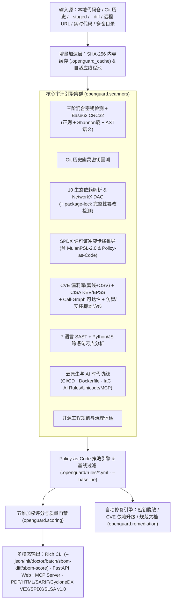

# OpenGuard 系统架构与核心算法说明 (v1.3+)

## 1. 总体分层架构

OpenGuard 采用**“采集与增量输入层 → 多引擎静态安全与供应链审计集群 → 智能降噪、可达性与策略治理层 → 量化评分与自动修复层 → 多模态交付层（CLI / Web / MCP / SDK / CI）”**的五层松耦合架构：

## 2. 关键核心算法与工程设计

### 2.1 三阶混合敏感信息检测与离线数学校验 (`SecretScanner`)

传统开源密钥扫描器在真实仓库中容易产生大量误报（文档示例、测试夹具、`re.compile(...)` 规则自身、SHA256 摘要或 UUID）。OpenGuard 设计了三阶递进流水线并结合最新离线校验算法：

1. **第一阶（指纹匹配与确定性数学校验）**：匹配 46+ 条覆盖云厂商、大模型平台、代码托管、国内 IM Webhook（飞书/钉钉/企微）、私钥与数据库的规则（含 GitLab 17+ Routable Token `OG-SEC-021`）；对结构化凭据执行确定性离线校验：
   - **GitHub / npm Token Base62 CRC32 校验**（`validate_github_token_crc32`，直接过滤随机伪造的 `ghp_`/`gho_`/`ghu_`/`ghs_`/`ghr_`/`npm_` 假密钥）；
   - **JWT Base64 JSON 头解析**、**18 位身份证 ISO 7064 MOD 11-2**、**银行卡 Luhn 校验**。
2. **第二阶（信息熵与占位符剔除）**：计算候选串 Shannon 信息熵 $H(X) = -\sum p_i \log_2 p_i$ 与字符类别多样性，剔除低熵重复串、占位符词根（`placeholder`、`example`、`your_`、`changeme`）、UUID 与纯十六进制摘要。
3. **第三阶（AST 语义打分与并发加速）**：解析 Python AST 与通用词法上下文，区分高危凭据变量与 `HASH`/`PATTERN`/`SAMPLE` 等非凭据变量，降权/过滤 `docstring`、`re.compile()`、`os.getenv()` 及单测作用域；文件数 $\ge 16$ 时启用自适应 `ThreadPoolExecutor` 与 SHA-256 内容增量缓存（`--cache`）。

### 2.2 10 生态依赖图、供应链完整性与 SBOM 治理 (`DependencyParser` + `sbom_tools`)

- **10 大生态静态解析**：PyPI（`requirements*.txt` / `pyproject.toml` / `uv.lock` / `poetry.lock`）、npm（`package.json` / `package-lock.json` / `yarn.lock` / `pnpm-lock.yaml`）、Go（`go.mod` / `go.sum`）、Cargo（`Cargo.toml` / `Cargo.lock`）、Maven（`pom.xml`）、NuGet（`*.csproj`）、RubyGems（`Gemfile.lock`）、Composer（`composer.json` / `composer.lock`）、C/C++（`vcpkg.json` / `conanfile.txt`）及 **GitHub Actions**（`pkg:githubactions`），基于 `NetworkX` 构建依赖有向图 $G=(V,E)$。
- **锁文件篡改与降级防线**：检查 `package-lock.json` 的明文 `http://` resolved 劫持（`OG-SUP-LOCK-001`）与缺失/弱 `sha1` integrity 校验（`OG-SUP-LOCK-002`）。
- **SBOM 差异分析与 NTIA 评分**：支持 CycloneDX 1.5（含 VEX `analysis`）与 SPDX 2.3 导出，提供 `openguard sbom-diff`（检测组件漂移、新增漏洞与 Copyleft 许可证引入）及对标 `sbomqs` 的 `openguard sbom-score`（NTIA/CISA 7 要素 0–10.0 评分）。

### 2.3 Call-Graph 可达性分析与 CISA KEV / EPSS 风险优先级 (`ReachabilityAnalyzer` + `VulnScanner`)

- **三级调用图可达性判定**：遍历 `.py`（AST）、`.js/.ts/.mjs`、`.go` 源码，结合包名-模块名映射表，将每个依赖及 CVE 精确标注为 `call_reachable`（函数级真实调用）、`import_only`（已导入）或 `unreachable`（未导入），并直接写入 CycloneDX 1.5 VEX `analysis` 节点。
- **P0–P3 威胁情报优先级**：内置 CISA KEV 在野利用目录与 EPSS 利用概率评估，结合可达性计算 `P0`（KEV 或高 EPSS 且可达）至 `P3` 修复优先级，帮助研发团队在海量告警中直击最紧迫漏洞。
- **离线漏洞库 + OSV 联动**：内置覆盖 2020–2026 高危生态漏洞库（含 React/Next.js/Brotli/Axios/Log4j/urllib3 等），联网模式下自动查询 OSV API（内置 Windows 代理容错 `trust_env=False` 回退）。

### 2.4 七语言 SAST、跨语句污点追踪与云原生/AI 时代防线

- **7 语言 SAST + 跨语句污点追踪**：
  - Python AST 安全扫描与 `PythonTaintAnalyzer`（`OG-TAINT-PY-001`–`004`：SQLi/RCE/SSRF/Path Traversal + 净化函数识别）；
  - JavaScript/TypeScript `JSTaintAnalyzer`（`OG-TAINT-JS-001`–`005`：RCE/XSS/SSRF/Path Traversal/Prototype Pollution）；
  - Go（`OG-SAST-GO-001`–`003`）、Java（`OG-SAST-JAVA-001`–`003`）、C/C++（`OG-SAST-CPP-001`–`002`）、Rust（`OG-SAST-RS-001`–`003`，识别 `// SAFETY:` 契约注释）。
- **AI 时代规则投毒防线 (`AIConfigSecurityScanner`)**：检测隐藏 Unicode Tag（`U+E0000`–`U+E007F` 自动解码还原载荷 `OG-AI-001`）、Trojan Source BiDi/零宽字符集群（`OG-AI-002`）、`.cursorrules`/`CLAUDE.md`/`AGENTS.md` 提示词注入（`OG-AI-003`）与 `.mcp.json` 危险命令投毒（`OG-AI-004`）。
- **CI/CD、容器与 IaC 安全扫描**：覆盖 GitHub Actions 工作流脚本注入与未 Pin SHA 动作（`OG-CI-001`–`006`）、Dockerfile 特权/硬编码密钥/浮动标签（`OG-DOCKER-001`–`005`）、Docker Compose / Kubernetes YAML / Terraform HCL（`OG-IAC-001`–`009`）。

### 2.5 Policy-as-Code、SLSA v1.0 供应链证明与开发者体验 (DX)

- **声明式策略引擎 (`PolicyEngine`)**：支持 `.openguard/rules/*.yml` 零代码自定义正则 SAST 规则，以及 `.openguard.yml` 中的 `policy.denied_licenses`、`allowed_licenses`、`denied_packages` 组织级合规拦截。
- **SLSA v1.0 / in-toto 完整性证明 (`slsa_provenance.py`)**：通过 `openguard attest generate|verify` 或 `--format slsa` 生成并校验带文件 SHA-256 摘要的 `in-toto v1` Statement。
- **AI Agent MCP Server (`openguard mcp`)**：零依赖 JSON-RPC 2.0 stdio MCP 服务，让 Claude Code / Cursor / Antigravity 在写代码和 `pip/npm install` 前实时校验代码片段与防 Slopsquatting 幻觉包。
- **企业级 CLI 体验与多仓组合审计**：
  - `openguard init`（自动探测仓库技术栈，幂等生成 `.openguard.yml`/`.openguardignore`/策略模板）；
  - `openguard doctor`（7 项环境与供应链就绪度体检及一键修复指引）；
  - `openguard scan --json --audit-mode`（纯净 stdout JSON 管道输出 + `0/1/2/3` 分级退出码协议）；
  - `openguard batch`（多仓批量扫描、SIEM JSONL 流式输出与 Markdown 排行榜）。

### 2.6 五维量化评估与确定性质量门禁 (`ScoringEngine` + `QualityGate`)

采用饱和指数衰减映射与权重加权聚合：
$$S_{\text{total}} = \sum_{i=1}^{5} w_i \cdot S_i, \quad S_{\text{sec/vuln/lic/sast}} = 100 \cdot \exp\left(-\frac{\sum p_k}{75}\right)$$
其中默认权重为：密钥安全 $30\%$、供应链漏洞 $20\%$、许可证合规 $20\%$、SAST 代码安全 $15\%$、开源工程治理 $15\%$；并同步评估 5 项硬性发布准入门禁（工作区零密钥、历史零密钥、零可达高危 CVE、零强传染冲突、零投毒脚本）输出 `PASSED / FAILED`。
