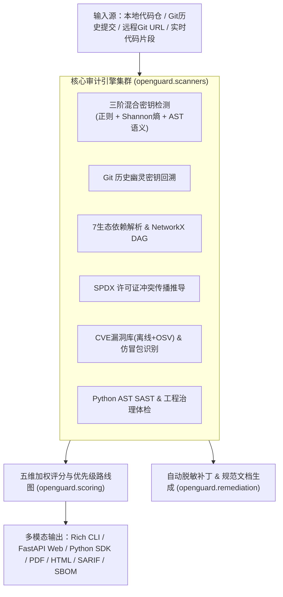

# OpenGuard 系统架构与核心算法说明

## 1. 总体分层架构

OpenGuard 采用**“采集输入层 → 五大核心审计引擎 → 量化评分与自动修复层 → 多模态交付层（CLI / Web / SDK / CI）”**的四层松耦合架构：

## 2. 关键核心算法设计

### 2.1 三阶混合敏感信息检测与降噪流水线 (`SecretScanner`)

传统开源密钥扫描器（如早期纯正则工具）在实际仓库中往往产生大量误报（例如文档示例代码、测试夹具、`re.compile(...)` 规则自身、SHA256 摘要或 UUID）。OpenGuard 设计了三阶递进流水线：

1. **第一阶（指纹匹配与确定性校验）**：匹配 46 条覆盖云厂商、大模型平台、代码托管、国内 IM Webhook（飞书/钉钉/企微）、私钥与数据库的正则模式；对结构化字段执行确定性算法校验（JWT Base64 JSON 头解析、18 位居民身份证 ISO 7064 MOD 11-2 校验位、银行卡 Luhn 算法）。
2. **第二阶（信息熵与占位符剔除）**：计算候选串的字符集 Shannon 信息熵 $H(X) = -\sum p_i \log_2 p_i$ 与字符类别多样性，自动剔除低熵重复串、常见占位符词根（`placeholder`、`example`、`your_`、`changeme` 等）、UUID 与未赋给凭据变量的纯十六进制摘要。
3. **第三阶（AST 抽象语法树上下文语义打分）**：解析 Python 源码 AST 与通用词法上下文，识别赋值目标变量名（提升 `API_KEY` 等置信度，大幅降权 `HASH`/`PATTERN`/`SAMPLE` 等非凭据变量）、自动识别并降权/过滤 `docstring` 文档字符串、`re.compile()` 正则定义、`os.getenv()` 调用及单元测试函数作用域。

### 2.2 依赖有向图与许可证传染性推导 (`DependencyParser` + `LicenseAnalyzer`)

- 静态解析 PyPI、npm、Go、Maven、Rust、C/C++、PHP 七大生态清单及锁文件（`package-lock.json`、`Cargo.lock` 等），构建基于 `NetworkX` 的依赖有向图 $G=(V,E)$。
- 识别项目主许可证（支持 MIT、Apache-2.0、BSD、GPL/AGPL/LGPL 及**木兰宽松许可证 MulanPSL-2.0**），通过 `nx.shortest_path` 定位强传染性依赖的最短传播链 `Project -> DirectDep -> TransitiveDep [GPL-3.0]`。

### 2.3 源码级 CVE 可达性分析与安装脚本投毒检测 (`ReachabilityAnalyzer` & `InstallScriptScanner`)

- **导入级可达性推导**：遍历项目 `.py`（AST `Import`/`ImportFrom`）、`.js/.ts/.mjs`（ES Import / CommonJS `require`）与 `.go` 源码，结合 PyPI 包名与模块名映射表（如 `PyYAML -> yaml`、`Pillow -> PIL`、`scikit-learn -> sklearn`），标记每个依赖与 CVE 是否真实被源码调用及其 `file:line` 位置，有效缓解传统 SCA 的海量误报疲劳。
- **安装脚本行为防线**：静态审计 `package.json` 中的 `preinstall`/`install`/`postinstall` 与 `setup.py` AST，拦截远程管道下载执行、Base64 混淆载荷与异常系统命令调用。

### 2.4 五维量化评估与确定性质量门禁 (`ScoringEngine` + `QualityGate`)

采用饱和指数衰减映射与权重加权聚合：
$$S_{\text{total}} = \sum_{i=1}^{5} w_i \cdot S_i, \quad S_{\text{sec/vuln/lic/sast}} = 100 \cdot \exp\left(-\frac{\sum p_k}{75}\right)$$
其中默认权重为：密钥安全 $30\%$、供应链漏洞 $20\%$、许可证合规 $20\%$、SAST 代码安全 $15\%$、开源工程治理 $15\%$；并同步评估 5 项硬性发布准入门禁（工作区零密钥、历史零密钥、零可达高危 CVE、零强传染冲突、零投毒脚本）输出 `PASSED / FAILED`。
